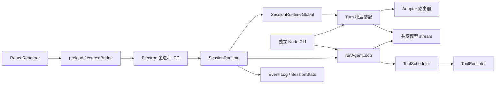
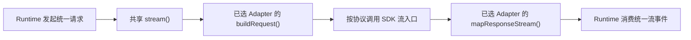
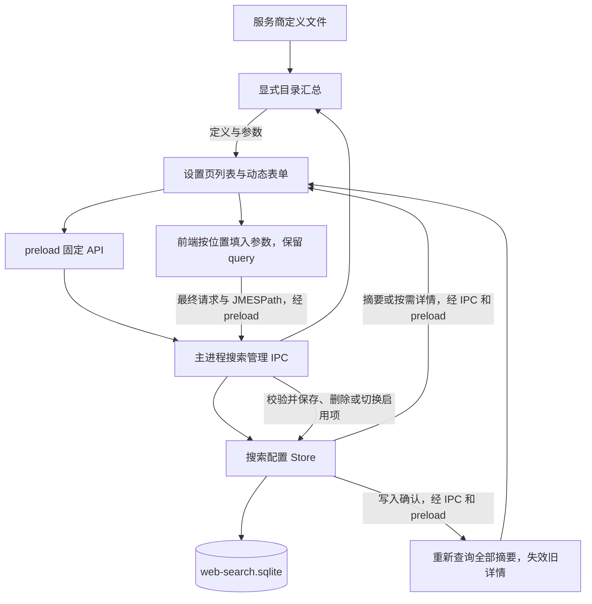

# Minou 架构与执行流程

本文记录 2026-10-30 当前实现。项目能力总览见 [项目概览](project-overview.md)，持久化格式见 [配置与持久化](configuration-and-storage.md)。每节列出的源码是核对行为的入口；不以旧注释中的阶段、章节号推断功能状态。

## 进程和模块边界



Renderer 负责页面、路由与展示缓存，不直接打开数据库、读取本机凭据文件或执行本机工具。preload 的 `window.minou` 提供对话、项目、模型、搜索配置、MCP 和 Skill 接口，`window.minouWindow` 提供窗口控制。搜索设置仅在编辑指定配置时通过专用 IPC 读取含凭据的完整请求，列表只保存摘要。主进程负责校验 IPC、持有活动实例、运行任务并推送已提交状态。

| 位置 | 实际职责 |
| --- | --- |
| `src/main/` | Electron 启动、窗口、配置和数据库、Project Context、IPC、进程级能力装配 |
| `src/preload/` | contextBridge、固定 IPC channel、参数和返回值契约 |
| `src/renderer/` | React 工作区、对话、设置、流式展示及缓存投影 |
| `src/cli/` | Headless 请求校验、独立装配、公开协议与结果文件 |
| `runtime/agent/` | Session 生命周期、Turn 队列、上下文组织与 Step 循环 |
| `runtime/model/` | 统一模型类型、Adapter 路由、流执行、三种协议转换、推理字段与 Usage |
| `runtime/session/` | 持久化事件、Meta、派生状态恢复、文件变化记录 |
| `runtime/context/` | Summary 请求与压缩阈值计算 |
| `runtime/tools/` | 注册、执行、结果整理、调度、权限和各类模型工具 |
| `runtime/mcp/`、`runtime/skill/`、`runtime/memory/` | 外部能力目录、技能来源与项目记忆本体 |
| `runtime/network/`、`runtime/error/`、`runtime/credential/` | HTTP Dispatcher 与重试、错误归一化、凭据契约 |

`runtime/project/` 当前只有占位，不承担实际 Project 管理；代码集中在 [project-ipc.ts](../src/main/project-ipc.ts)、[workspace-store.ts](../src/main/workspace-store.ts) 与 [project-context.ts](../src/main/project-context.ts)。

## 桌面启动

[electron-main.ts](../src/main/electron-main.ts) 依次初始化配置快照、网络 Dispatcher、ToolRegistry / RenderRegistry，探测并试启动预期的 MXC 后端，再注册文件和记忆工具并创建 `SessionRuntimeGlobal`。该对象持有共享 SkillManager、MCPManager、ShellRouter、TerminalRouter 和统一工具执行入口；构造时登记相应工具。桌面进程内所有会话共用 32 个 PTY 名额。`terminal_open` 新建并执行首条命令，`terminal_input` 复用终端或空读输出。满额时按最近使用时间淘汰最久未使用的 PTY，包括仍在运行的终端。

入口在读取配置前获取单实例锁，重复启动时由主实例显示并聚焦窗口。入口登记窗口 IPC，再调用 [startElectronApp](../src/main/index.ts) 注册对话、项目、供应商、MCP、Skill 等 IPC 并按配置连接 MCP。单个 MCP 服务初始化失败会记录错误，其余启动流程继续。Electron ready 后创建原生托盘与首个窗口。

[electron-windows.ts](../src/main/electron-windows.ts) 持有主窗口并加载编译 preload 和 Vite 页面。开发时由 `MINOU_RENDERER_URL` 改为加载 Vite 地址。窗口无系统边框，自绘关闭按钮通过 [window-ipc.ts](../src/main/window-ipc.ts) 发起原生窗口关闭请求。最小化、最大化和状态同步也使用窗口 IPC。

[electron-tray.ts](../src/main/electron-tray.ts) 持有原生托盘并处理窗口关闭。默认在 Windows、macOS 隐藏窗口，Linux 或托盘初始化失败时最小化。托盘点击切换窗口状态，「显示 Minou」、macOS Dock 激活和第二实例请求恢复同一窗口，窗口已销毁时由窗口管理器重建。设置选择「退出 Minou」时，关闭按钮与托盘退出走同一个应用退出流程。退出期间禁止恢复窗口，等待桌面设置写入和 Shell、PTY、MCP 清理完成，最终在 `will-quit` 释放托盘。Windows 系统会话结束时由窗口事件触发尽力清理。

桌面入口通过 `createTrustedIpcMain` 注册管理接口。每次调用都要求发送者是存活主窗口的主 frame，且 frame 和 WebContents 的当前地址均匹配入口文档，允许 hash 路由。主窗口拒绝导航到其他文档和外部重定向，并将直接打开的 HTTP(S) 外链和弹窗交给系统浏览器。会话更新仅广播给仍在入口文档的主窗口。内置浏览器继续使用自己的网页视图管理流程。

## 一次桌面对话调用

1. 首页与 [session-page.tsx](../src/renderer/session-page.tsx) 把 [Composer](../src/renderer/composer-input.tsx) 的 Tiptap JSON [序列化](../src/renderer/composer-message.ts) 为一个文本块，经 preload 请求新建或继续会话；运行中发送的消息请求入队。文件节点展开为绝对路径，并附上供展示的 `fileReferences`。
2. [session-ipc.ts](../src/main/session-ipc.ts) 以 Project + Session 联合身份管理活动 Runtime，校验参数并转发命令。
3. [SessionRuntime](../runtime/agent/src/session-runtime.ts) 绑定会话目录、事件日志和 SessionState。新建或继续 Turn 时，先提交 `turn/start` 与 `user/message`；提交失败不启动模型循环。
4. Turn 真正开始时读取所选模型和推理等级，通过 `SessionRuntimeGlobal.createTurnModelAdapter()` 从同一 Provider 数据库快照取得 Provider 名称、模型规格、协议配置和凭据。模型支持思考时校验所选等级。路由器随后选定转换器，工厂把它与本轮 SDK Client 绑定到共享流入口，后续 Step 复用此入口。
5. Runtime 组织工作区说明、AGENTS.md / Skill 基线和基础工具，再调用 `runAgentLoop()`。
6. Loop 将 Step、完整内容块和完整消息提交到 Event Log，并通过 SessionRuntime 在内存中发布块开始与增量；若产生工具调用，就运行工具小轮并把 ToolResult 回填上下文，然后进入下一 Step。
7. Runtime 负责 Turn 完成、失败、停止、文件变化与派生状态同步，再消费 FIFO 队列。Queue 仅保存消息内容，不提前冻结后续 Turn 的模型。
8. 主进程按 Project + Session 独立缓冲块开始和增量，首个待发片段开启一次 50 ms 定时。定时到期发送片段数组，期间收到已提交事件、控制状态或错误时立即连同待发片段一起发送。Renderer 的 [session-state.ts](../src/renderer/session-state.ts) 每包合并一次，按持久化序号合并历史，并用 Step 内的 `streamSeq` 和最近一次已提交的 `afterSeq` 插入流片段。活动会话查询返回当前 Step 的内存片段，Step 结束后释放。

Composer 的 `@` 查询调用 [文件查看器 IPC](../src/main/file-explorer-ipc.ts)，用现有 ripgrep 枚举能力搜索当前项目的关联目录。会话 IPC 在接收结构化引用时校验目录关联、真实文件与正文位置。队列与 `user/message` 事件携带引用，模型历史只读取 `content`。历史和 Composer 的文件标签共用内置浏览器标签管理器及只读预览，打开时再次检查目录授权和目标文件。

模型配置的必填 `supportsReasoning` 从 Provider 数据库快照传入 Adapter。三个协议共用的推理请求片段仅在该字段为 true 时校验等级并拼装字段；普通请求和上下文压缩遵循相同规则。false 时忽略会话中保留的等级，不改变 ModelRef 或 Meta 的结构。CLI 将本次 `--supportreason` 的值传给 Adapter 工厂，默认开启，推理字段路径与可选等级仍来自模型配置。

桌面新对话提交首条消息后，SessionRuntime 用本轮 Adapter 发起独立的标题请求，主回复与队列可同时执行。标题请求只携带首条消息和命名提示词，优先使用该模型支持的关闭或最低思考档位。活动期停止会放弃命名，60 秒超时则使用消息前 30 个字符。主进程仅在 Meta 名称仍为「新对话」时原子写入，再同步工作区索引并推送会话摘要。

桌面与 CLI 共用 [Turn 模型工厂](../src/main/model-adapters.ts)。[路由器](../runtime/model/src/gateway/adapter-router.ts) 优先匹配忽略大小写及首尾空白的 Provider 名称或别名。名称命中但不支持所选协议时结束装配并报错。名称未命中时按 API 模型名与协议匹配，模型名支持精确名称和大小写敏感的末尾 `*` 前缀规则。多个转换器同时命中时报告冲突。生产表按 `DeepSeek` 名称或 `deepseek-*` 与对应协议的组合选择 DeepSeek 转换器，按 `Anthropic` 名称或 `claude-*` 与 `anthropic_messages` 的组合选择 Anthropic 转换器。OpenAI 转换器支持 `responses` 和 `chat_completions`，按 `OpenAI` 名称或 `gpt*`、`GPT*` 与所选协议的组合匹配。OpenRouter 的 `chat_completions` 转换器通过 `OpenRouter` 和 `Open Router` 两种名称匹配。未匹配到专用条目时按协议选择通用条目。SDK Client 在 Turn 装配时创建，Provider 凭据留在宿主和 SDK。

## 桌面 Team Mode

聊天页头的「团队模式」通过 preload 的 `startTeamSession` 提交首条消息。主进程在首轮事件事务中保存 Router 与 Workspace 身份，返回会话、Turn 和 Workspace ID。历史查询的 `kind` 与首个实时事件携带的 `sessionKind` 都来自主进程识别的会话角色，Renderer 据此选中对应模式。普通聊天与 Router 共用 `SessionPage`、原会话路由、侧栏及搜索。列表索引从普通事件表生成，成员事件单独保存在 Team 事件表。

Router 页头的「团队成员」通过可信会话 IPC 查询同一 Workspace 的成员 ID。选择成员时，内置浏览器打开只读对话标签。工作台先登记接收，再订阅成员并读取历史，将查询期间到达的事件按序号合并。主进程按项目、成员及窗口维护内存订阅，只向订阅窗口投递成员的事件、控制状态和错误。取消订阅、主文档重载、渲染进程退出或窗口销毁会移除对应订阅。

成员标签与普通聊天共用对话记录组件，缓存和更新通道独立。切走或收起浏览器时卸载成员记录组件，后台增量只进入成员缓存，也不触发侧栏摘要查询。关闭标签后保留已读取的工作台内存缓存，重开时重新订阅并查询历史以补齐缺口。

主进程消费普通会话和 Router 已提交的 `user/message` 或 `turn/end` 时，核对该分组的工作区会话索引。成员的这两类事件只走成员更新通道，随后按原流程结算成员状态和检查队列。

[TeamMode](../src/main/team-mode.ts) 使用启动时读取的 `config.json.teamWakeup` 运行唤醒判断与计时。设置 IPC 确认文件保存后更新生效参数并重排空闲成员的计时。Router 派单、成员反馈和黑板唤醒仍由协作调度器入队。

成员继承创建时 Router 的沙箱。权限检查触发审批时，成员使用本轮模型自动审核，派单与唤醒在审核材料中标为 `team_context`。只有有效且明确批准的低风险结果允许继续执行。Router 和普通会话按自身权限设置处理审批。

## Step、协议与 Usage



共享 `stream()` 在每次逻辑请求开始时构造协议请求，并通过同一重试逻辑执行协议请求。每次网络尝试分别转换响应流，使用独立的分片状态。原生历史的启用条件由各 Adapter 根据模型、Provider 名称和请求上下文判断。SDK 自身重试保持关闭。

[loop.ts](../runtime/agent/src/loop.ts) 处理 `step/start`、模型块事件、`assistant/message`、`tool/result`、`step/end`，不承担宿主的 Turn 首尾。模型块包括 thinking、text 和 tool_call。工具结果通过 `toolCallId` 和对应块事件的 `toolCallEventId` 关联，不能只依据日志排列顺序配对。

模型类型见 [types.ts](../runtime/model/src/types.ts)，Adapter 将各协议转成同一事件与内容结构。Usage 的 `inputTokens` 排除缓存读取与缓存写入，`reasoningTokens` 是 `outputTokens` 的一部分。总量按 `inputTokens + outputTokens + (cacheReadTokens ?? 0) + (cacheWriteTokens ?? 0)` 校验。厂商总量缺失时填入分项和，上报值与分项和不同时省略 `totalTokens`。缓存字段缺失仍保持缺失。具体映射见 [usage.ts](../runtime/model/src/usage.ts)。

AgentLoop 在带用量的 `assistant/message` 中携带该请求 Adapter 的 `contextWindow`。Session 从这些事件累计 `inputTokens`、缓存读取 `cacheHitTokens` 和缓存写入 `cacheMissTokens`，命中率是缓存读取量除以三个累计输入桶的总和。最近一次上下文占用取该次请求的输入与输出分项和，占用率用该占用除以同一请求的模型上限。Renderer 从会话事件按相同口径展示用量。

[通用 Chat Completions Adapter](../runtime/model/src/gateway/openai-chat-completions-adapter.ts) 按分片依次从非空的 `reasoning_content`、`reasoning` 和 `reasoning_details` 的文本或摘要提取可读思考。通用请求将同一 assistant 消息的 thinking 块按顺序拼接到 `reasoning_content`。字段依据见 [Z.AI 深度思考](https://docs.z.ai/guides/capabilities/thinking) 和 [MiniMax OpenAI SDK](https://platform.minimax.io/docs/api-reference/text-openai-api)。

[OpenRouter Adapter](../runtime/model/src/gateway/openrouter-adapter.ts) 为每段连续思考选择首个有效文本的来源，同一分片同时提供两种文本时优先使用 `reasoning_details[].text`。段内从同一来源推送前端增量并累积 thinking 文本。转换器独立组装两种原生推理字段，在流结束时把完整 JSON 附到最后一个 thinking 块，以 `OpenRouter` 和 `chat_completions` 标记来源。历史请求按该固定来源读取并直接回传 JSON 中的推理字段，缺少匹配回放的 thinking 文本会被跳过。请求使用模型配置的 `max_completion_tokens` 和推理档位。 [OpenRouter Chat Completions 转换](../runtime/model/src/gateway/openrouter/openai-chat-completions-adapter.ts) · [OpenRouter Reasoning Tokens](https://openrouter.ai/docs/guides/best-practices/reasoning-tokens)

[OpenAI Adapter](../runtime/model/src/gateway/openai-adapter.ts) 的 Responses 请求设置 `store: false`，只从 `response.output_item.done` 将含密文的完整 reasoning item 保存为 `OpenAI` / `responses` 回放。每个 item 对应独立 thinking 块，无可读文本时块文本为空。下一次请求在历史块的原位置回传符合固定来源的 item。Chat Completions 使用官方消息和工具格式，两种协议均发送模型配置的输出上限。 [OpenAI 推理回放指南](https://developers.openai.com/api/docs/guides/reasoning#keeping-reasoning-items-in-context) · [Responses 流式事件](https://developers.openai.com/api/reference/resources/responses/streaming-events#response.output_item.added)

[Xai Adapter](../runtime/model/src/gateway/xai-adapter.ts) 的 Responses 请求使用客户端历史和 `max_output_tokens`。转换器按原生 `output_index` 排列块，从 `response.output_item.done` 保存带密文的完整 reasoning item，缺少密文时可从终态的 `response.output` 补取。回放固定使用 `Xai` / `responses`，下一轮按历史块的位置回传原生项。请求省略密文 `include` 参数。Chat Completions 使用 `max_tokens`，将 `reasoning_content` 转为可读 thinking，并在 Usage 中将单列的推理消耗计入输出。 [xAI 流式事件](https://docs.x.ai/developers/model-capabilities/text/streaming) · [xAI 推理回放](https://docs.x.ai/developers/model-capabilities/text/reasoning#encrypted-reasoning-content) · [xAI Chat Completions](https://docs.x.ai/developers/rest-api-reference/inference/chat-completions)

[DeepSeek Adapter](../runtime/model/src/gateway/deepseek-adapter.ts) 将三种协议的请求构造和流解析实现在 [DeepSeek 目录](../runtime/model/src/gateway/deepseek/) 内，共享网关负责 SDK 传输。各协议下发模型输出上限，并在思考能力关闭或选中 `none` 时显式关闭思考。Chat Completions 在携带工具定义时把历史 thinking 拼入 `reasoning_content`，Responses 用明文 `reasoning` 输入项回放，Anthropic Messages 用已有 `replay` 字段保存同来源的完整内容块和签名，工具定义放在请求顶层。独立摘要省略这些回放。 [思考模式](https://api-docs.deepseek.com/zh-cn/guides/thinking_mode/) · [Responses](https://api-docs.deepseek.com/zh-cn/guides/responses_api/) · [Anthropic Messages](https://api-docs.deepseek.com/zh-cn/guides/anthropic_api/)

网络层由 [retry.ts](../runtime/network/src/retry.ts) 控制重试，当前最大尝试次数为 3。可重试错误在尚无有效输出时重试；已产生有效流事件后失败，交由当前请求错误流程处理。取消不自动重试。

## 工具执行与权限

[tool-registry.ts](../runtime/tools/src/tool-registry.ts) 登记定义与业务执行函数，RenderRegistry 登记结果整理器。[tool-executor.ts](../runtime/tools/src/tool-executor.ts) 统一查表、检查业务参数、执行并整理 ToolResult；普通工具错误以结果返回模型，结果整理器失败时使用公共错误回退。

[tool-scheduler.ts](../runtime/tools/src/tool-scheduler.ts) 按模型调用顺序切轮。连续共享只读调用同轮并发，独占调用各自成轮；上一轮结束后才启动下一轮，同轮谁先完成谁先交出结果。共享名单为 `glob`、`grep`、`read`、`skill_load`、`memory_list`、`memory_read`、`mcp_list_tools`、`web_search`、`web_fetch`；未在名单中的工具，包括动态 MCP 工具，默认独占。

`web_search` 在桌面与 CLI 入口成对登记工具和后端 render，不修改 SessionRuntimeGlobal。启动流程初始化用户 `.minou/web-search.sqlite`；执行时从中读取当前唯一启用项，对保存的完整请求字符串替换 `${query}`，再解析 JSON、分离 `url` 并向 fetch 透传其余配置。请求与响应读取共用取消信号和 30 秒超时，不自动重试；停止后返回 `CANCELLED`，超时返回独立搜索错误。此流程不调用模型网络重试器。JMESPath 负责输出 `WebSearchItem[]`，工具保留现有数组检查，并使用宿主注入的 `estimateLocalTokens` 将每条字符串 `snippet` 限制为至多 800 token（含末尾省略号），不拆开代理对、不保存完整摘要，其它字段保持原值，再包装成 `WebSearchResult`；专属 render 输出编号、标题、URL、摘要与可选发布时间，再由现有 Loop 写入事件和回填上下文。未配置、请求与解析错误以普通工具错误返回，不携带请求凭据或原始响应。实现见 [web-search](../runtime/tools/src/web-search/index.ts) 与 [render](../runtime/tools/src/render/web-search.ts)。

`web_fetch` 同样在桌面与 CLI 入口成对登记，不读取搜索服务商配置。模型仅提供 `{ url }`，参数校验要求绝对 HTTP/HTTPS URL。GET 请求显式处理 301/302/303/307/308，最多跟随 5 次重定向，相对 Location 按当前 URL 解析，跳转目标仅允许 HTTP/HTTPS。超过次数返回 `WEB_FETCH_TOO_MANY_REDIRECTS`；无效目标返回 `WEB_FETCH_INVALID_REDIRECT`，缺少 Location 沿用 HTTP 错误。整条跳转链与完整正文读取共用 Stop 信号和 30 秒超时，不自动重试；按解压后的响应流逐块累计字节，最多 5,242,880 字节，超过立即取消请求、清空缓冲并返回 `WEB_FETCH_TOO_LARGE`，不返回部分正文。未压缩响应的 Content-Length 可提前拒绝，但不替代流式计数。HTML/XHTML 由 Turndown 默认规则转换为 Markdown，并移除 script/style；text/plain 与 text/markdown 原样返回，缺少 Content-Type 时尝试按 HTML 处理，其余类型失败。实现见 [web-fetch](../runtime/tools/src/web-fetch/index.ts) 与 [render](../runtime/tools/src/render/web-fetch.ts)。

抓取业务输入仍为 `WebFetchInput { url: string }`。转换后的最终文本按 UTF-8 字节计算，至多 32,768 字节时返回 `{ text }`，超过时保留不拆分字符的开头，并将完整处理文本独占写入当前 `tool_output/web_fetch_<UUID>.md`。`WebFetchResult` 此时附带 `truncated: true`、`totalBytes` 和 `fullOutputPath`。目录复用 `context.processRuntime.outputDirectory`，不调用进程审批、不改变读取权限；目录无效或写入失败返回 `WEB_FETCH_OUTPUT_WRITE_FAILED`，不交付部分正文或虚假的成功路径。后端 render 在正文末尾追加省略号、截断说明、全文绝对路径及使用 read 的提示（提示另计），再变为现有单文本块 ToolResult，错误复用 AppError。Loop 继续记录 tool/result 并回填模型。Renderer 不新增状态或 IPC：按 turn、step、toolCallId 关联工具卡片，展开后以纯文本代码块显示 Markdown 原文；失败显示现有错误说明。Assistant 后续正文仍走 Markdown 展示。30 秒覆盖网络与读取，读取完成后的同步转换不另建执行线程。

桌面内置文件和进程工具使用[会话权限表](../runtime/tools/src/security/permissions.ts)。新会话的工作区目录为只读，未覆盖的路径和进程网络默认拒绝。`READ` 允许读取，`WRITE` 同时允许读取和写入。子路径规则覆盖祖先。切换工作区只读或读写时更新关联目录对应的权限，其余长期授权保留。当前会话的工具输出可由文件工具读取。

模型在操作因权限不足失败时，或在执行命令前预判现有权限不足时，通过 `request_permissions` 申请长期授权。同一路径需要读写时，只需填写 `path.write`。读取路径、写入路径和网络分别产生审批项。SessionRuntime 复用现有审批事件和浮层，逐项等待决定，批准项立即写入 Session Meta。已拒绝的项由工具结果汇总。同一工具调用可对应多项先后完成的审批。

[MXC 装配](../runtime/tools/src/security/mxc.ts)选择 Windows 11 24H2 及以上的 `processcontainer` 或 Linux 的 `bubblewrap`。应用启动时检查 SDK 支持并创建探测进程，失败进入受阻模式。Windows 若显式拒绝进程工作目录的上级路径，当前调用返回错误，避免 PowerShell 在系统盘根目录启动。普通 Shell、PTY 创建使用 MXC，`temporary` 在启动前逐项批准并合并本次权限，`unrestricted` 展示完整命令并等待人工确认。完全访问 Shell 使用原生 spawn，Windows 完全访问 PTY 使用 node-pty，Linux MXC 完全访问 PTY 授予当前用户主目录读写并开放网络。无法进入指定工作目录时，调用报错。受阻模式下，进程工具要求显式 `unrestricted`，经批准走原生后端；文件工具继续执行会话权限检查和显式完全访问审批，拒绝临时模式。已有 PTY 保持创建时的权限，`terminal_input` 按所属会话找到并续写，空输入仍用于读取输出。

当前权限表管理内置文件工具和 MXC 进程。CLI、服务配置、MCP 及独立网络工具各自使用原有宿主边界。

桌面「自动审核」沿用工作区读写的权限边界。路径及网络的显式申请进入审批时，[SessionRuntime](../runtime/agent/src/session-runtime.ts) 按原顺序分流到[独立模型审核](../runtime/agent/src/tool-approval.ts)。审核复用本轮 Adapter、模型和标题请求的低思考档位选择，只发送本轮用户消息、助手正文、已有结果的工具调用及其文本结果，以及单列的待审调用，不提供可调用工具。高风险必须拒绝。无效输出最多重试两次，模型请求失败或从取得审批槽位起 30 秒内无有效决定时拒绝，用户停止则取消。自动审核不发布人工审批事件，仍由 Loop 写入工具结果。显式 `unrestricted` 走人工审批；成员的只读记录无审批入口，因此该模式对成员返回拒绝。

`read` 每行最多返回 2,000 个 UTF-16 单元，续读边界保留 Unicode 代理对。遇到超长行时结束当前页，并给出同一行的 `nextOffset` 和 `nextColumn`。模型可按提示传入 `offset` 和 `column` 继续读取。`column` 从 1 开始，仅作用于起始行，越过行尾或落在代理对内部会报错。因行数或 50 KiB 文本预算停止时，可从下一条未读取行继续。

## 固定上下文、外部能力与恢复

- [project-context.ts](../src/main/project-context.ts) 从数据库读取 Project，选择首个关联目录作为 cwd；没有关联目录时使用内置 workspace。当前 cwd 下的 AGENTS.md 和启用 Skill 组成基线，允许根包括内置 workspace 与关联目录。
- Skill 启用项按名称合并，Project 同名来源覆盖 Global，禁用的 Project 项也可屏蔽 Global；描述进入上下文，正文通过 `skill_load` 按需读取。来源历史按 scope + path 区分，已有来源的状态变化静默同步。
- MCPManager 共享连接和完整 Catalog，各 Session 单独记录载入身份。`tool_search` 搜索并载入，或经 `mcp_list_tools` / `mcp_load_tools` 载入。预算为模型窗口的 5%，按最近调用记录淘汰；单批自身超预算时仍整批载入。实际载入和淘汰产生有序增量。同一次载入先提交移除、再提交带定义快照的新增，事件提交后同步 Session Meta。显式重新载入同名工具也提交当前定义快照，覆盖后续请求中的旧定义；新载入计数不包含刷新项。模型请求使用历史定义，真正执行仍由当前 Catalog 校验工具和参数。
- Memory 不默认把正文注入系统消息；模型通过三件记忆工具按需访问当前 Project/default 的共享 Markdown。
- Event Log 是已执行事实的恢复依据，SessionState 据此修复 Meta、`contextstate.json` 与 `agents_md.snapshot`，不能把页面缓存作为持久化事实。

事件日志的 `appendEvent` 在原写入事务中只读取并校验当前会话的尾部事件，再分配下一个序号。MCP 增量批量写入、Turn 首批写入和完整读取仍检查全量历史。尾部之前的记录损坏由下一次全量校验报告。桌面重启后，恢复流程用已提交的 `assistant/block_end` 重建缺失的 Assistant 消息，再收尾中断的 Step 和 Turn。崩溃时尚未提交的块随内存片段丢弃。

## 桌面 Summary

SessionRuntime 在正常 Step 前把最近一次正常 Agent 请求完成后的上下文占用量（完整输入加输出）与下方阈值比较。

```text
min(contextWindow × 0.8, contextWindow - maxOutputTokens - (10000 + maxOutputTokens))
```

达到阈值时写入 `summary/start`，用当前 Turn Adapter 发起独立压缩请求。该请求禁用工具，要求完整、非空、正常结束的文本。成功后提交带覆盖事件范围和完整基线的 `summary/end`，再切换后续上下文；失败不会提交成功摘要。日志保留完整事件。 MCP 快照按摘要覆盖的同一截止序号折叠，与摘要一并提交，随后写入 contextstate。实现见 [summary.ts](../runtime/context/src/summary.ts) 与 SessionRuntime 的 `startLoop()`。

### Step 历史与协议转换

每个正常 Step 从宿主取得已提交的有序历史。最近成功的 `summary/end` 是历史的首项，其 MCP 快照作为工具基线。Builder 结合基础工具、基线和后续事件构造消息与工具表。桌面和 CLI 共用这一请求形状，CLI 首轮以空 MCP 基线启动，续跑用同一套 SessionState 重放已提交的载入事件。标题和独立 Summary 继续传显式消息。

Anthropic 专用 Adapter 用 `Anthropic` / `anthropic_messages` 保存原生块。`thinking` 累积思考文本与签名，`redacted_thinking` 单独存为文本为空的统一 thinking 块，密文保留在原生 JSON 中。请求按块回放来源名称严格等于 `Anthropic` 的 JSON，其他 thinking 块跳过。首次回放原生思考块时固定顶层工具表，后续增量按序作为内联变更放在整组工具结果后，同名工具新增用于替换定义。系统提示中的 AGENTS.md 与 Skill 使用持久化基线，普通 Turn 的 AGENTS.md 变化只追加 `context_update` 并更新比较快照，成功 Summary 才替换固定基线。独立 Summary 将通用消息作为文本材料。历史的系统提示和消息前缀仍需满足服务端的签名校验。 [Anthropic Messages 转换](../runtime/model/src/gateway/anthropic/anthropic-messages-adapter.ts) · [Claude 签名前缀规则](https://platform.claude.com/docs/en/build-with-claude/preserved-thinking/change-tools-or-instructions)

## 搜索服务配置管理

[搜索设置](../src/renderer/web-search-settings.tsx) 复用现有设置弹窗的列表—详情布局与忙碌保护。服务商定义在 [providers](../src/main/web-search-providers.ts) 显式汇总，每个配置文件声明名称、表单参数、字段位置、JSON 请求模板和 JMESPath。预置包括 Tavily、DeepSeek Search、Exa 和 Bocha；数量均默认 5，上限及鉴权填写格式见 [配置与持久化](configuration-and-storage.md)。新增服务商沿用相同 IPC、参数绑定与搜索执行流程。

Renderer 从 [web-search-ipc.ts](../src/main/web-search-ipc.ts) 获取目录和无凭据摘要，选中记录后才获取完整请求，并通过 [provider-template.ts](../runtime/tools/src/web-search/provider-template.ts) 按字段路径还原参数，校验并移除定义中的固定前缀。保存时也由该纯函数模块按位置填入参数并添加固定前缀，分别序列化内层 body 与外层请求，保留 `${query}`，再通过 preload 提交。Tavily、DeepSeek、Bocha 的表单只填写 Key，绑定器负责生成 Bearer 鉴权头。主进程校验目录身份、参数、固定响应映射及存储语法，创建时生成 UUID；存储保持新建停用、更新保留状态和唯一启用事务。

每次写入确认后，前端重新读取全部摘要并替换列表缓存，同时清除旧详情参数，再按需重读当前记录。写入成功但刷新失败时禁用旧缓存操作，只允许重试读取；不会重复保存。完整请求不进入列表缓存，密钥仅保留在当前详情表单，离开后释放。本流程不增加跨窗口推送，不改变搜索工具执行逻辑。



## CLI 独立调用

[main.ts](../src/cli/main.ts) 直接装配配置、Adapter、工具、MCP、Skill、Memory 和独立事件日志，调用相同的 `runAgentLoop()`。它不创建桌面 SessionRuntime，也不注册 Electron IPC。首次 run 分配内部 UUID，日志位于 `logs/cli/<session-id>/`。

首次 run 保存有效设置和固定上下文。continue 按会话 ID 恢复 EventLog 和 SessionState，复用桌面的上下文比较逻辑，并在同一事务提交增量及新 Turn 的首批事件。CLI 每个会话的设置数据库提供跨进程独占，首次允许的 MCP 工具身份约束后续目录发布。

两个入口共用 Loop 的事件提交规则。桌面端通过实时发布回调和 IPC 推送块开始和增量。完整块、消息、Step 和工具结果通过 `appendEvent` 提交到各自的 SQLite Event Log。CLI 的 JSONL 输出在日志提交成功后逐行输出完整事件。

CLI 在装配阶段按模块隔离选项与 MCP 来源选择初始化工具。启用内置工具白名单时，CLI 从本次注册的内置工具中校验名称，并同时约束模型收到的定义和实际执行入口。远端 MCP 工具继续通过 Run 内的载入事件开放。`auto` 将权限检查触发的审批交给现有 `reviewToolCall()`，并在 CLI 事件日志记录审批请求和决定。

CLI 默认 100 Step、1800 秒总时限，收尾宽限为 5 秒。[protocol.ts](../src/cli/protocol.ts) 按已提交事件累计 Turn、Step 和工具调用，使用本次运行最近一次上报的 Agent 请求用量，并取最后一条 Assistant Message 的文本作为 `answer`。stdout 以 JSONL 逐行输出已提交事件。显式指定 `--output` 时写入 UTF-8 回答文本，指定 `--outputjson` 时写入包含运行状态、统计、回答和日志路径的 JSON 文件。启动参数、审批、隔离与退出码见 [CLI 使用说明](cli-usage.md)。
