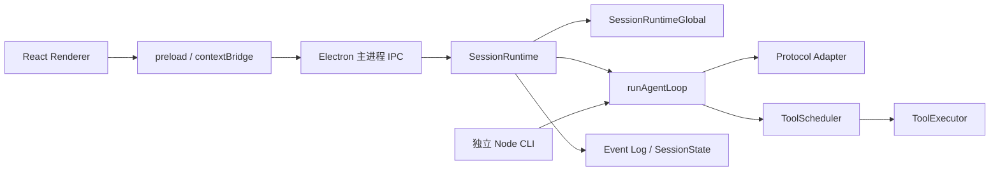
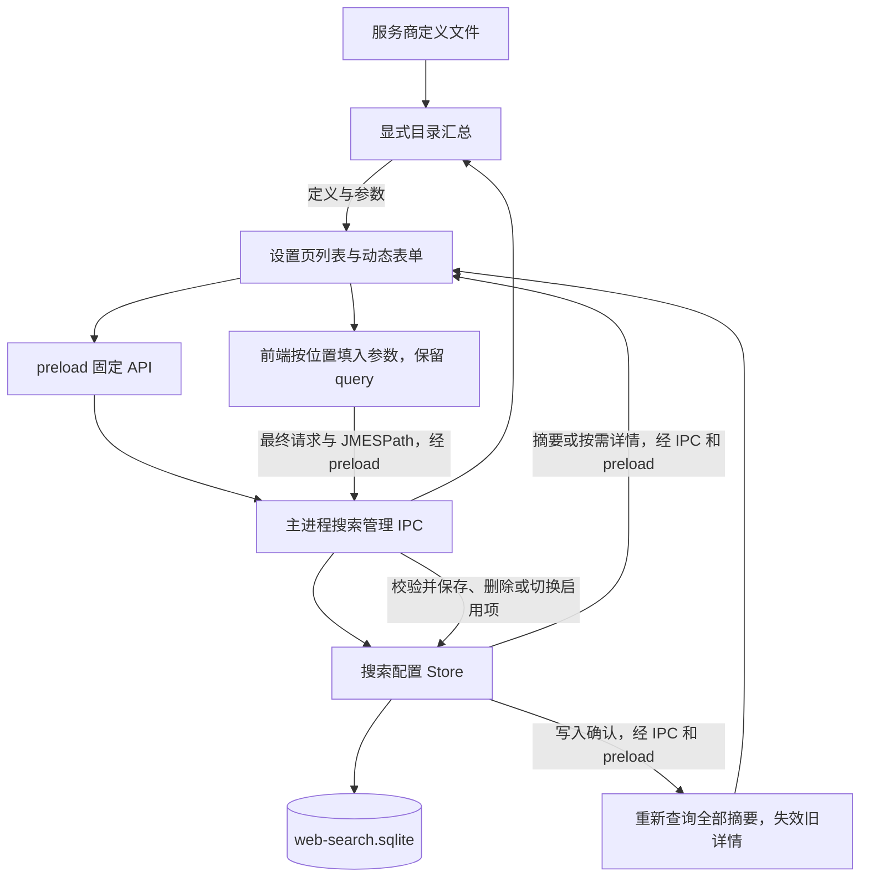

# NiCode 架构与执行流程

本文记录 2026-10-30 当前实现。项目能力总览见 [项目概览](project-overview.md)，持久化格式见 [配置与持久化](configuration-and-storage.md)。每节列出的源码是核对行为的入口；不以旧注释中的阶段、章节号推断功能状态。

## 进程和模块边界



Renderer 负责页面、路由与展示缓存，不直接打开数据库、读取本机凭据文件或执行本机工具。preload 的 `window.nicode` 提供对话、项目、模型、搜索配置、MCP 和 Skill 接口，`window.nicodeWindow` 提供窗口控制。搜索设置仅在编辑指定配置时通过专用 IPC 读取含凭据的完整请求，列表只保存摘要。主进程负责校验 IPC、持有活动实例、运行任务并推送已提交状态。

| 位置 | 实际职责 |
| --- | --- |
| `src/main/` | Electron 启动、窗口、配置和数据库、Project Context、IPC、进程级能力装配 |
| `src/preload/` | contextBridge、固定 IPC channel、参数和返回值契约 |
| `src/renderer/` | React 工作区、对话、设置、流式展示及缓存投影 |
| `src/cli/` | Headless 请求校验、独立装配、公开协议与结果文件 |
| `runtime/agent/` | Session 生命周期、Turn 队列、上下文组织与 Step 循环 |
| `runtime/model/` | 统一模型类型、三种 Adapter、推理字段与 Usage 转换 |
| `runtime/session/` | 持久化事件、Meta、派生状态恢复、文件变化记录 |
| `runtime/context/` | Summary 请求与压缩阈值计算 |
| `runtime/tools/` | 注册、执行、结果整理、调度、权限和各类模型工具 |
| `runtime/mcp/`、`runtime/skill/`、`runtime/memory/` | 外部能力目录、技能来源与项目记忆本体 |
| `runtime/network/`、`runtime/error/`、`runtime/credential/` | HTTP Dispatcher 与重试、错误归一化、凭据契约 |

`runtime/project/` 当前只有占位，不承担实际 Project 管理；代码集中在 [project-ipc.ts](../src/main/project-ipc.ts)、[workspace-store.ts](../src/main/workspace-store.ts) 与 [project-context.ts](../src/main/project-context.ts)。

## 桌面启动

[electron-main.ts](../src/main/electron-main.ts) 依次初始化配置快照、网络 Dispatcher、ToolRegistry / RenderRegistry，注册文件和记忆工具，然后创建一个 `SessionRuntimeGlobal`。该对象持有共享 SkillManager、MCPManager、ShellRouter、TerminalRouter 和统一工具执行入口；构造时登记相应工具。

入口在读取配置前获取单实例锁，重复启动时由主实例显示并聚焦窗口。入口登记窗口 IPC，再调用 [startElectronApp](../src/main/index.ts) 注册对话、项目、供应商、MCP、Skill 等 IPC 并按配置连接 MCP。单个 MCP 服务初始化失败会记录错误，其余启动流程继续。Electron ready 后创建原生托盘与首个窗口。

[electron-windows.ts](../src/main/electron-windows.ts) 持有主窗口并加载编译 preload 和 Vite 页面。开发时由 `NICODE_RENDERER_URL` 改为加载 Vite 地址。窗口无系统边框，自绘关闭按钮通过 [window-ipc.ts](../src/main/window-ipc.ts) 发起原生窗口关闭请求。最小化、最大化和状态同步也使用窗口 IPC。

[electron-tray.ts](../src/main/electron-tray.ts) 持有原生托盘并处理窗口关闭。默认在 Windows、macOS 隐藏窗口，Linux 或托盘初始化失败时最小化。托盘点击切换窗口状态，「显示 NiCode」、macOS Dock 激活和第二实例请求恢复同一窗口，窗口已销毁时由窗口管理器重建。设置选择「退出 NiCode」时，关闭按钮与托盘退出走同一个应用退出流程。退出期间禁止恢复窗口，等待桌面设置写入和 Shell、PTY、MCP 清理完成，最终在 `will-quit` 释放托盘。Windows 系统会话结束时由窗口事件触发尽力清理。

桌面入口通过 `createTrustedIpcMain` 注册管理接口。每次调用都要求发送者是存活主窗口的主 frame，且 frame 和 WebContents 的当前地址均匹配入口文档，允许 hash 路由。主窗口拒绝导航到其他文档和外部重定向，并将直接打开的 HTTP(S) 外链和弹窗交给系统浏览器。会话更新仅广播给仍在入口文档的主窗口。内置浏览器继续使用自己的网页视图管理流程。

## 一次桌面对话调用

1. [session-page.tsx](../src/renderer/session-page.tsx) 经 preload 请求新建或继续会话；运行中发送的消息请求入队。
2. [session-ipc.ts](../src/main/session-ipc.ts) 以 Project + Session 联合身份管理活动 Runtime，校验参数并转发命令。
3. [SessionRuntime](../runtime/agent/src/session-runtime.ts) 绑定会话目录、事件日志和 SessionState。新建或继续 Turn 时，先提交 `turn/start` 与 `user/message`；提交失败不启动模型循环。
4. Turn 真正开始时读取所选模型和推理等级，通过 `SessionRuntimeGlobal.createTurnModelAdapter()` 打开 Provider 数据库，取得同一快照的模型规格、协议配置和凭据。模型支持思考时校验所选等级后，创建仅供本 Turn 使用的 Adapter；后续 Step 复用它。
5. Runtime 组织工作区说明、AGENTS.md / Skill 基线和基础工具，再调用 `runAgentLoop()`。
6. Loop 写入 Step、Assistant 流事件和完整消息；若产生工具调用，就运行工具小轮并把 ToolResult 回填上下文，然后进入下一 Step。
7. Runtime 负责 Turn 完成、失败、停止、文件变化与派生状态同步，再消费 FIFO 队列。Queue 仅保存消息内容，不提前冻结后续 Turn 的模型。
8. 主进程通过会话更新事件推送已提交内容和控制状态，Renderer 的 [session-state.ts](../src/renderer/session-state.ts) 合并历史与增量，供页面展示。

模型配置的必填 `supportsReasoning` 从 Provider 数据库快照传入 Adapter。三个协议共用的推理请求片段仅在该字段为 true 时校验等级并拼装字段；普通请求和上下文压缩遵循相同规则。false 时忽略会话中保留的等级，不改变 ModelRef 或 Meta 的结构，CLI 也使用相同的能力判断。

桌面新对话提交首条消息后，SessionRuntime 用本轮 Adapter 发起独立的标题请求，主回复与队列可同时执行。标题请求只携带首条消息和命名提示词，优先使用该模型支持的关闭或最低思考档位。活动期停止会放弃命名，60 秒超时则使用消息前 30 个字符。主进程仅在 Meta 名称仍为「新对话」时原子写入，再同步工作区索引并推送会话摘要。

模型工厂见 [model-adapters.ts](../src/main/model-adapters.ts)。启动阶段不预先为全部模型创建 SDK Client，也不把 Provider 凭据快照传入 Renderer。

## Step、协议与 Usage

[loop.ts](../runtime/agent/src/loop.ts) 处理 `step/start`、模型块事件、`assistant/message`、`tool/result`、`step/end`，不承担宿主的 Turn 首尾。模型块包括 thinking、text 和 tool_call。工具结果通过 `toolCallId` 和对应块事件的 `toolCallEventId` 关联，不能只依据日志排列顺序配对。

模型类型见 [types.ts](../runtime/model/src/types.ts)，Adapter 将各协议转成同一事件与内容结构。Usage 的 `inputTokens` 是未缓存输入；完整输入还包含已报告的 `cacheReadTokens`、`cacheWriteTokens`。`reasoningTokens` 属于输出子集，不应再次相加。可选桶未报告时保持缺失，其累计规则也不能简单视为零。具体映射见 [usage.ts](../runtime/model/src/usage.ts)。Session 的 `RealUsage` 是另一个派生结构，其中 `inputTokens` 表示最近一次正常 Agent 请求的完整输入，不可与统一 Usage 同名字段混用。

[Chat Completions Adapter](../runtime/model/src/chat-completions.ts) 按分片依次从非空的 `reasoning_content`、`reasoning` 和 `reasoning_details` 的文本或摘要提取可读思考。通用请求将同一 assistant 消息的 thinking 块按顺序拼接到 `reasoning_content`。OpenRouter 优先回传匹配来源的完整 `reasoning_details`，缺失或无法解析时改用 `reasoning`。独立摘要请求使用通用文本转换。字段依据见 [DeepSeek 思考模式](https://api-docs.deepseek.com/guides/thinking_mode/)、[Z.AI 深度思考](https://docs.z.ai/guides/capabilities/thinking)、[MiniMax OpenAI SDK](https://platform.minimax.io/docs/api-reference/text-openai-api) 和 [OpenRouter Reasoning Tokens](https://openrouter.ai/docs/guides/best-practices/reasoning-tokens)。

网络层由 [retry.ts](../runtime/network/src/retry.ts) 控制重试，当前最大尝试次数为 3。可重试错误在尚无有效输出时重试；已产生有效流事件后失败，交由当前请求错误流程处理。取消不自动重试。

## 工具执行与权限

[tool-registry.ts](../runtime/tools/src/tool-registry.ts) 登记定义与业务执行函数，RenderRegistry 登记结果整理器。[tool-executor.ts](../runtime/tools/src/tool-executor.ts) 统一查表、检查业务参数、执行并整理 ToolResult；普通工具错误以结果返回模型，结果整理器失败时使用公共错误回退。

[tool-scheduler.ts](../runtime/tools/src/tool-scheduler.ts) 按模型调用顺序切轮。连续共享只读调用同轮并发，独占调用各自成轮；上一轮结束后才启动下一轮，同轮谁先完成谁先交出结果。共享名单为 `glob`、`grep`、`read`、`terminal_list`、`skill_load`、`memory_list`、`memory_read`、`mcp_list_tools`、`web_search`、`web_fetch`；未在名单中的工具，包括动态 MCP 工具，默认独占。

`web_search` 在桌面与 CLI 入口成对登记工具和后端 render，不修改 SessionRuntimeGlobal。启动流程初始化用户 `.nicode/web-search.sqlite`；执行时从中读取当前唯一启用项，对保存的完整请求字符串替换 `${query}`，再解析 JSON、分离 `url` 并向 fetch 透传其余配置。请求与响应读取共用取消信号和 30 秒超时，不自动重试；停止后返回 `CANCELLED`，超时返回独立搜索错误。此流程不调用模型网络重试器。JMESPath 负责输出 `WebSearchItem[]`，工具保留现有数组检查，并使用宿主注入的 `estimateLocalTokens` 将每条字符串 `snippet` 限制为至多 800 token（含末尾省略号），不拆开代理对、不保存完整摘要，其它字段保持原值，再包装成 `WebSearchResult`；专属 render 输出编号、标题、URL、摘要与可选发布时间，再由现有 Loop 写入事件和回填上下文。未配置、请求与解析错误以普通工具错误返回，不携带请求凭据或原始响应。实现见 [web-search](../runtime/tools/src/web-search/index.ts) 与 [render](../runtime/tools/src/render/web-search.ts)。

`web_fetch` 同样在桌面与 CLI 入口成对登记，不读取搜索服务商配置。模型仅提供 `{ url }`，参数校验要求绝对 HTTP/HTTPS URL。GET 请求显式处理 301/302/303/307/308，最多跟随 5 次重定向，相对 Location 按当前 URL 解析，跳转目标仅允许 HTTP/HTTPS。超过次数返回 `WEB_FETCH_TOO_MANY_REDIRECTS`；无效目标返回 `WEB_FETCH_INVALID_REDIRECT`，缺少 Location 沿用 HTTP 错误。整条跳转链与完整正文读取共用 Stop 信号和 30 秒超时，不自动重试；按解压后的响应流逐块累计字节，最多 5,242,880 字节，超过立即取消请求、清空缓冲并返回 `WEB_FETCH_TOO_LARGE`，不返回部分正文。未压缩响应的 Content-Length 可提前拒绝，但不替代流式计数。HTML/XHTML 由 Turndown 默认规则转换为 Markdown，并移除 script/style；text/plain 与 text/markdown 原样返回，缺少 Content-Type 时尝试按 HTML 处理，其余类型失败。实现见 [web-fetch](../runtime/tools/src/web-fetch/index.ts) 与 [render](../runtime/tools/src/render/web-fetch.ts)。

抓取业务输入仍为 `WebFetchInput { url: string }`。转换后的最终文本按 UTF-8 字节计算，至多 32,768 字节时返回 `{ text }`，超过时保留不拆分字符的开头，并将完整处理文本独占写入当前 `tool_output/web_fetch_<UUID>.md`。`WebFetchResult` 此时附带 `truncated: true`、`totalBytes` 和 `fullOutputPath`。目录复用 `context.processRuntime.outputDirectory`，不调用进程审批、不改变读取权限；目录无效或写入失败返回 `WEB_FETCH_OUTPUT_WRITE_FAILED`，不交付部分正文或虚假的成功路径。后端 render 在正文末尾追加省略号、截断说明、全文绝对路径及使用 read 的提示（提示另计），再变为现有单文本块 ToolResult，错误复用 AppError。Loop 继续记录 tool/result 并回填模型。Renderer 不新增状态或 IPC：按 turn、step、toolCallId 关联工具卡片，展开后以纯文本代码块显示 Markdown 原文；失败显示现有错误说明。Assistant 后续正文仍走 Markdown 展示。30 秒覆盖网络与读取，读取完成后的同步转换不另建执行线程。

文件权限由 [security/index.ts](../runtime/tools/src/security/index.ts) 和规范路径判断实现：Full Access 直接允许；Sandbox Full Access 对允许根内访问直接允许；Sandbox Read Only 对根内读取直接允许，其他文件操作需要审批。审批事件与等待结果由 SessionRuntime 持有。Shell、PTY、MCP 使用各自工具实现中的检查；不能把文件规则推定为所有工具共有的系统级限制。

`read` 每行最多返回 2,000 个 UTF-16 单元，续读边界保留 Unicode 代理对。遇到超长行时结束当前页，并给出同一行的 `nextOffset` 和 `nextColumn`。模型可按提示传入 `offset` 和 `column` 继续读取。`column` 从 1 开始，仅作用于起始行，越过行尾或落在代理对内部会报错。因行数或 50 KiB 文本预算停止时，可从下一条未读取行继续。

## 固定上下文、外部能力与恢复

- [project-context.ts](../src/main/project-context.ts) 从数据库读取 Project，选择首个关联目录作为 cwd；没有关联目录时使用内置 workspace。当前 cwd 下的 AGENTS.md 和启用 Skill 组成基线，允许根包括内置 workspace 与关联目录。
- Skill 启用项按名称合并，Project 同名来源覆盖 Global，禁用的 Project 项也可屏蔽 Global；描述进入上下文，正文通过 `skill_load` 按需读取。来源历史按 scope + path 区分，已有来源的状态变化静默同步。
- MCPManager 共享连接和完整 Catalog，各 Session 单独记录载入身份。`tool_search` 搜索并载入，或经 `mcp_list_tools` / `mcp_load_tools` 载入。预算为模型窗口的 5%，按最近调用记录淘汰；单批自身超预算时仍整批载入。实际载入和淘汰产生有序增量。同一次载入先提交移除、再提交带定义快照的新增，事件提交后同步 Session Meta。模型请求使用历史定义，真正执行仍由当前 Catalog 校验工具和参数。
- Memory 不默认把正文注入系统消息；模型通过三件记忆工具按需访问当前 Project/default 的共享 Markdown。
- Event Log 是已执行事实的恢复依据，SessionState 据此修复 Meta、`contextstate.json` 与 `agents_md.snapshot`，不能把页面缓存作为持久化事实。

事件日志的 `appendEvent` 在原写入事务中只读取并校验当前会话的尾部事件，再分配下一个序号。MCP 增量批量写入、Turn 首批写入和完整读取仍检查全量历史。尾部之前的记录损坏由下一次全量校验报告。

## 桌面 Summary

SessionRuntime 在正常 Step 前依据最近一次正常 Agent 请求的完整输入量检查阈值：

```text
min(contextWindow × 0.8, contextWindow - maxOutputTokens - (10000 + maxOutputTokens))
```

达到阈值时写入 `summary/start`，用当前 Turn Adapter 发起独立压缩请求。该请求禁用工具，要求完整、非空、正常结束的文本。成功后提交带覆盖事件范围和完整基线的 `summary/end`，再切换后续上下文；失败不会提交成功摘要。日志保留完整事件。 MCP 快照按摘要覆盖的同一截止序号折叠，与摘要一并提交，随后写入 contextstate。实现见 [summary.ts](../runtime/context/src/summary.ts) 与 SessionRuntime 的 `startLoop()`。

### Step 历史与协议转换

每个正常 Step 从宿主取得已提交的有序历史。最近成功的 `summary/end` 是历史的首项，其 MCP 快照作为工具基线。Builder 结合基础工具、基线和后续事件构造消息与工具表。桌面和 CLI 共用这一请求形状，CLI 以空基线和 Run 内载入状态启动。标题和独立 Summary 继续传显式消息。

Adapter 按协议和模型名前缀匹配原生回放能力。使用 `anthropic_messages` 且模型名以 `claude` 开头时启用，适用于官方和代理地址，回放来源为 `anthropic` / `anthropic_messages`。完整且匹配的 Assistant 消息逐块回放，其他消息走通用转换。首次回放带签名或加密数据的思考块时固定顶层工具表，后续增量按序作为内联变更放在整组工具结果后。启用回放能力的 Adapter 将独立 Summary 的通用消息作为文本材料。历史的系统提示和消息前缀仍需满足服务端的签名校验。

## 搜索服务配置管理

[搜索设置](../src/renderer/web-search-settings.tsx) 复用现有设置弹窗的列表—详情布局与忙碌保护。服务商定义在 [providers](../src/main/web-search-providers.ts) 显式汇总，每个配置文件声明名称、表单参数、字段位置、JSON 请求模板和 JMESPath。预置包括 Tavily、DeepSeek Search、Exa 和 Bocha；数量均默认 5，上限及鉴权填写格式见 [配置与持久化](configuration-and-storage.md)。新增服务商沿用相同 IPC、参数绑定与搜索执行流程。

Renderer 从 [web-search-ipc.ts](../src/main/web-search-ipc.ts) 获取目录和无凭据摘要，选中记录后才获取完整请求，并通过 [provider-template.ts](../runtime/tools/src/web-search/provider-template.ts) 按字段路径还原参数，校验并移除定义中的固定前缀。保存时也由该纯函数模块按位置填入参数并添加固定前缀，分别序列化内层 body 与外层请求，保留 `${query}`，再通过 preload 提交。Tavily、DeepSeek、Bocha 的表单只填写 Key，绑定器负责生成 Bearer 鉴权头。主进程校验目录身份、参数、固定响应映射及存储语法，创建时生成 UUID；存储保持新建停用、更新保留状态和唯一启用事务。

每次写入确认后，前端重新读取全部摘要并替换列表缓存，同时清除旧详情参数，再按需重读当前记录。写入成功但刷新失败时禁用旧缓存操作，只允许重试读取；不会重复保存。完整请求不进入列表缓存，密钥仅保留在当前详情表单，离开后释放。本流程不增加跨窗口推送，不改变搜索工具执行逻辑。



## CLI 独立调用

[main.ts](../src/cli/main.ts) 直接装配配置、Adapter、工具、MCP、Skill、Memory 和独立事件日志，调用相同的 `runAgentLoop()`。它不创建桌面 SessionRuntime，也不注册 Electron IPC。每次使用内部 UUID，日志位于 `logs/cli/<session-id>/`，外部 `run_id` 仅作为关联字段。

CLI 默认 100 Step、1800 秒总时限，有限收尾宽限为 5 秒。公开输出通过 [protocol.ts](../src/cli/protocol.ts) 的白名单映射，排除 thinking 和工具参数/结果正文；最后一条 Assistant Message 文本成为 `answer`。完整内部日志与公开结果用途不同。请求字段、审批、隔离与退出码见 [CLI 使用说明](cli-usage.md)。
